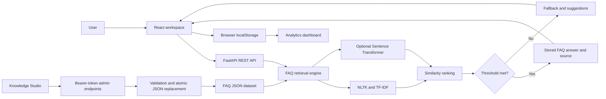

<div align="center">

# QueryMind AI

### Intelligent FAQ Retrieval & Knowledge Operations

**CodeAlpha Artificial Intelligence Internship — Task 2**


*Ask. Retrieve. Understand. Improve.*

[Features](#features) · [Architecture](#architecture) · [Installation](#local-installation) · [Knowledge Studio](#knowledge-studio) · [API](#api-reference) · [Roadmap](#roadmap)

</div>

---

## Overview

QueryMind is an NLP-powered customer support demonstration that retrieves grounded answers from a curated FAQ knowledge base. It combines a React workspace, FastAPI service, explainable retrieval, browser voice capabilities, conversation analytics and administrator-controlled knowledge management.

The original lexical NLP engine remains the default. An optional multilingual Sentence Transformer model adds semantic matching without requiring a paid LLM API.

> Educational demonstration: the supplied ecommerce FAQs describe an imaginary business. QueryMind is a retrieval assistant, not a general-purpose generative AI or a production customer support platform.

## Features

| Workspace | Capabilities |
| --- | --- |
| AI Assistant | Topic-aware FAQ chat, suggested questions, fallback responses, response actions and expandable conversation view |
| Response Intelligence | Similarity scores, matched source, category, client-measured latency and retrieval pipeline summary |
| Conversation History | Browser-local saved conversations, search, rename, delete, copy and transcript download |
| FAQ Library | Searchable questions, category navigation and one-click questions |
| Voice Controls | Browser speech recognition, speech synthesis, available voice selection, playback speed and stop controls |
| Analytics | 7/14/30-day windows, six KPI cards, activity line chart, outcome donut, topic distribution, feedback and unmatched-question review, CSV export |
| Knowledge Studio | Token-protected FAQ management, draft editing, category filters, JSON import/export, duplicate checks and explicit publishing |
| Interface | Navy/champagne-gold design, light/dark themes, responsive layout and independently scrollable conversation area |
| AI Engine | Default NLTK/TF-IDF retrieval and optional multilingual semantic/lexical fusion |

## Architecture



## Retrieval methodology

The lexical pipeline normalizes English text, removes custom stop words, applies NLTK Snowball stemming, and fits scikit-learn TF-IDF unigram/bigram vectors on questions and their alternative phrasings. Queries are ranked by cosine similarity with optional category restriction.

| Configuration | Lexical engine (default) | Hybrid engine (optional) |
| --- | --- | --- |
| Model | TF-IDF | paraphrase-multilingual-MiniLM-L12-v2 |
| Ranking | Lexical cosine similarity | 25% lexical + 75% semantic similarity |
| Default threshold | 0.20 | 0.45 |
| Language | English preprocessing | Multilingual query embeddings |
| Output | Stored FAQ answer | Stored FAQ answer |

Scores are similarity measurements, **not calibrated probabilities or verified answer accuracy**. Hybrid weights and thresholds are initial heuristics and require evaluation. Multilingual retrieval does not translate the stored answers. The current intelligence panel summarizes retrieval rather than exposing actual model execution traces; its lexical pipeline labels do not fully reflect hybrid mode.

## Technology stack

| Layer | Technology |
| --- | --- |
| UI | React 18, TypeScript 5, Vite 5, Lucide React, CSS, SVG |
| API | Python 3.10+, FastAPI, Uvicorn, Pydantic |
| NLP | NLTK, scikit-learn, NumPy |
| Optional semantic model | Sentence Transformers |
| Persistence | JSON FAQ file and browser localStorage |
| Voice | Web Speech APIs |
| Testing | Pytest, FastAPI TestClient, TypeScript/Vite build; Vitest script |

## Local installation

### Prerequisites

Python 3.10+ (3.11 or 3.12 recommended for optional ML dependencies), Node.js 20+, Git. Docker is not required.

### 1. Clone

```bash
cd ~/Documents
git clone https://github.com/yasmeenmh90-beep/CodeAlpha_FAQ_Chatbot.git
cd CodeAlpha_FAQ_Chatbot/backend
python3 -m venv .venv
source .venv/bin/activate
python -m pip install --upgrade pip
python -m pip install -r requirements.txt python-dotenv
```

### 2. Configure a persistent local administrator token

Run from the backend directory. This preserves an existing token and protects the local environment file from accidental Git uploads.

```bash
python - <<'PY'
from pathlib import Path
import secrets

p = Path(".env")
lines = p.read_text().splitlines() if p.exists() else []
if not any(line.startswith("QUERYMIND_ADMIN_TOKEN=") for line in lines):
    lines.append("QUERYMIND_ADMIN_TOKEN=" + secrets.token_hex(24))
p.write_text("\n".join(lines) + "\n")
p.chmod(0o600)
ignore = Path(".gitignore")
old = ignore.read_text() if ignore.exists() else ""
if ".env" not in old.splitlines():
    ignore.write_text(old + "\n.env\n")
PY
git check-ignore .env
```

Keep the token private. Read it locally from the file when unlocking Knowledge Studio. Never commit .env or publish credentials.

### 3. Start backend

```bash
python -m uvicorn app.main:app --reload --port 8000 --env-file .env
```

### 4. Start frontend in a second terminal

```bash
cd ~/Documents/CodeAlpha_FAQ_Chatbot/frontend
npm install
npm run dev
```

| Service | URL |
| --- | --- |
| Workspace | http://localhost:5173 |
| API | http://127.0.0.1:8000 |
| Swagger | http://127.0.0.1:8000/docs |
| Health | http://127.0.0.1:8000/api/health |

The Vite development server proxies /api requests to port 8000. Keep both terminals running.

### Optional: enable hybrid retrieval

Stop the backend, activate its virtual environment and run:

```bash
python -m pip install sentence-transformers
export QUERYMIND_SEMANTIC=1
python -m uvicorn app.main:app --reload --port 8000 --env-file .env
```

The first model initialization may download model files and take time. To return to lexical mode, stop the server, unset QUERYMIND_SEMANTIC and remove any corresponding setting in .env before restarting.

## Knowledge Studio

1. Open Knowledge Studio in the sidebar.
2. Enter the administrator token from backend/.env and unlock.
3. Search or filter records; add, edit or delete FAQ drafts.
4. Import or export JSON as needed.
5. Select Publish changes and confirm the complete dataset replacement.

The server validates the proposed dataset, rejects duplicate IDs and questions, writes a replacement file atomically and invalidates the cached retrieval engine. The next retrieval rebuilds the index. Keep a JSON backup before publishing. The file-based design is intended for single-process local use, not concurrent multi-user editing.

Example FAQ record:

```json
{
  "id": "faq-example",
  "category": "account",
  "question": "How do I reset my password?",
  "answer": "Use the password reset option on the sign-in page.",
  "alternatives": ["I forgot my password"]
}
```

## Analytics dashboard

Analytics uses current and saved conversations available in the browser, not centralized production telemetry. Match rate is matched responses divided by evaluated retrieval responses, not independently measured accuracy. Latency is client-measured request duration. Feedback is based on explicit user ratings. Missing measurements are shown as unavailable. CSV export contains daily questions and matched replies.

## API reference

| Method | Endpoint | Purpose |
| --- | --- | --- |
| GET | /api/health | Service health and FAQ count |
| GET | /api/faqs | List FAQ questions, optionally by category |
| GET | /api/categories | Available categories |
| POST | /api/chat | Retrieve answer, score, category and suggestions |
| GET | /api/admin/faqs | Read complete knowledge base (protected) |
| PUT | /api/admin/faqs | Replace complete knowledge base (protected) |

```bash
curl -X POST http://127.0.0.1:8000/api/chat \
  -H 'Content-Type: application/json' \
  -d '{"message":"I forgot my password","category":"all"}'
```

Response fields: engine, answer, matched_question, confidence, matched, category, suggestions. Admin endpoints require Authorization: Bearer TOKEN. The PUT body contains a faqs array of records.

## Troubleshooting

| Issue | Solution |
| --- | --- |
| No module named app | Run Uvicorn from the backend directory with its virtual environment activated |
| Admin 503 | Start backend with --env-file .env and ensure QUERYMIND_ADMIN_TOKEN is configured |
| Admin 401 | Enter the exact current token |
| Admin 404 | Pull latest main and restart backend |
| Connection refused | Verify the backend is running on port 8000 |
| Model initialization slow | Allow first download or disable optional semantic mode |
| Microphone unavailable | Use a supported browser and grant microphone permission |
| Old UI after changes | Pull latest main and refresh the browser |

## Testing and quality

From backend with the virtual environment activated:

```bash
python -m pytest -q
```

From frontend:

```bash
npm install
npm run build
```

Existing tests cover baseline matching and API behavior. Recent enhancements still require comprehensive regression testing, semantic retrieval evaluation and browser verification. No new passing test results are claimed here.

Recommended evaluation: top-1 accuracy on labeled FAQ queries, recall@3, abstention on unrelated queries, multilingual paraphrases, latency and admin authorization tests.

## Privacy and security

- Chat history and feedback are stored in browser localStorage; they are not a server-side chat database.
- Queries are sent to the FastAPI backend for retrieval.
- Browser speech recognition may use the browser vendor's external speech service.
- Admin access is disabled unless a token is configured; tokens are compared server-side.
- Use HTTPS for remote deployments, keep secrets on the server and restrict CORS.
- Publishing FAQ changes modifies a server-side JSON file. Use backups and persistent storage.
- Basic process-local rate limiting is implemented. Production authentication, distributed rate limiting, audit logging and concurrent editing controls remain future work.

## Deployment

The frontend can be built for static hosting such as Vercel, with FastAPI hosted separately on Render or an equivalent service. Configure VITE_API_URL before building the frontend, add the deployed frontend origin to the backend CORS allowlist, set secrets through the hosting environment and provide persistent storage for knowledge changes. A live deployment has not been verified.

## Project structure

```text
CodeAlpha_FAQ_Chatbot/
├── backend/
│   ├── app/
│   │   ├── main.py          API and admin operations
│   │   └── engine.py        Lexical and optional hybrid retrieval
│   ├── data/faqs.json       Knowledge base
│   ├── tests/               Baseline automated tests
│   └── requirements.txt
├── frontend/
│   ├── src/
│   │   ├── App.tsx           Assistant and workspace navigation
│   │   ├── Analytics.tsx     Analytics and charts
│   │   ├── KnowledgeAdmin.tsx Knowledge Studio
│   │   └── styles.css        Responsive themes and UI
│   ├── package.json
│   └── vite.config.ts
└── README.md
```

## Roadmap

| Capability | Status |
| --- | --- |
| FAQ assistant, history, voice controls and library | Implemented |
| Analytics dashboard and response intelligence | Implemented |
| Optional hybrid multilingual retrieval | Implemented in code; evaluation pending |
| Knowledge Studio and protected API | Implemented; regression testing pending |
| Dedicated voice mode with live waveform | Implemented in code; verification pending |
| PDF ingestion and document RAG | Implemented in code; verification pending |
| AI Playground | Implemented in code; verification pending |
| System Monitor | Implemented in code; verification pending |
| Support Tickets | Implemented in code; verification pending |
| Settings Studio | Implemented in code; verification pending |
| Multilingual answer translation | Implemented in code; verification pending |
| Regression tests, CI and deployment configuration | Added; verification and live hosting pending |

---

<div align="center">

**Built for the CodeAlpha Artificial Intelligence Internship**

Task 2 — Chatbot for FAQs

[GitHub repository](https://github.com/yasmeenmh90-beep/CodeAlpha_FAQ_Chatbot)

</div>


## Advanced workspace modules (Phases 7–13)

| Module | Capabilities |
|---|---|
| Voice Studio | Browser recognition, microphone visualization, editable transcript, speech playback |
| Document Studio | PDF extraction, local preview, TF-IDF passage retrieval and page citations |
| Multilingual chat | Six languages, optional external Google/MyMemory translation, bounded rule-based follow-up context |
| AI Playground | TF-IDF and optional hybrid ranking, configurable experimental thresholds, labeled evaluation, JSON export |
| System Monitor | Protected process-local request telemetry, latency, P95 and HTTP errors |
| Support Tickets | SQLite persistence, explicit submission, protected queue and resolution notes |
| Settings Studio | Shared theme, voice and context preferences, browser conversation storage and export controls |

Document retrieval is extractive, not LLM generation. Scanned PDFs require OCR, which is not implemented. PDF limits: 5 MiB, 100 pages, 200,000 extracted characters. Non-English translation sends question and answer text to an external service. Browser speech recognition may also use external services. Answer language resets on reload.

### Additional API routes

| Method | Path | Access |
|---|---|---|
| POST | /api/documents/extract | Public |
| POST | /api/documents/query | Public |
| GET | /api/playground/modes | Public |
| POST | /api/playground/rank | Public |
| POST | /api/playground/evaluate | Public |
| GET | /api/monitor | Admin |
| POST | /api/tickets | Public |
| GET | /api/admin/tickets | Admin |
| PUT | /api/admin/tickets/{ticket_id} | Admin |

### Quality and deployment safeguards

Run backend tests from backend with `python -m pytest -q`, and frontend build from frontend with `npm run build`. GitHub Actions runs these checks on pushes to main and pull requests. Check the actual workflow result before releasing; the existence of a workflow is not proof of passing tests.

Configure explicit comma-separated frontend origins using `QUERYMIND_CORS_ORIGINS`. Wildcard origins are excluded. Keep the existing admin token secret. Set `QUERYMIND_TICKET_DB` to a writable persistent SQLite path if needed. Default ticket database files are ignored by Git.

API POST/PUT bodies are bounded to 2 MiB (5 MiB for PDF extraction). Fixed-window per-process IP limits are 10 write requests/minute for expensive endpoint groups and 60/minute for other API write groups. Shared proxy IPs, multiple workers and server restarts affect these limits. Production needs trusted proxy configuration, HTTPS, durable storage, upstream limits, dependency review and authentication appropriate to the deployment.

Monitoring holds the last 500 completed API requests in memory, without request bodies or tokens. Ticket submission does not contact external support staff. Evaluation smoke-test examples reuse FAQ questions; they are not independent accuracy evidence. Browser data deletion does not erase server tickets.


## Optional deployment guide (not required for local submission)

1. Verify backend tests and frontend production build locally; review the Quality checks workflow on GitHub.
2. In Render, connect this repository using a Blueprint and the root render.yaml. Supply the exact HTTPS frontend origin as QUERYMIND_CORS_ORIGINS (update after obtaining the Vercel URL). The blueprint generates an admin secret and disables automatic deployment. Deploy manually after checks pass. Keep the secret server-side.
3. Open the deployed backend /api/health endpoint and verify successful JSON output.
4. In Vercel, import the same repository, set Root Directory to frontend, select Vite and set VITE_API_URL to the actual HTTPS Render service URL without a trailing slash. Deploy.
5. Set QUERYMIND_CORS_ORIGINS on Render to the actual Vercel origin, then restart/redeploy the backend. Rebuild the frontend whenever VITE_API_URL changes.
6. Smoke-test chat, document upload, evaluation, tickets, admin access and browser settings over HTTPS.

The initial Render configuration uses a free service for demonstration. Cold starts and ephemeral filesystem storage are expected limitations. Do not use the free filesystem for valuable FAQ edits or customer tickets. For durable storage, choose a hosting plan with a persistent volume, mount it and configure QUERYMIND_FAQ_FILE and QUERYMIND_TICKET_DB to files on that volume. Keep one API worker with the current process-local administration and telemetry design.

Optional semantic retrieval is disabled by default to reduce memory usage. No hosting credentials are committed. Never place QUERYMIND_ADMIN_TOKEN in a VITE_ variable. No live URL is claimed until hosting and smoke tests succeed.

## Release checklist

- [ ] Backend regression suite passes
- [ ] Frontend production build passes
- [ ] Dependency vulnerabilities reviewed
- [ ] All studios tested in browser on desktop and mobile
- [ ] GitHub Actions passes
- [ ] Local backend health and frontend verified
- [ ] Admin access and unauthorized access tested
- [ ] Data persistence limitations documented
- [ ] Local demo recording and repository link added for submission


## Final local submission and reproducible evaluation

This project is submitted as a local educational demonstration. No live deployment is required. The optional deployment instructions above are retained for future use.

### Consolidated verification

From the backend directory, with the virtual environment activated:

```bash
export QUERYMIND_SEMANTIC=0
python -m compileall -q app
python -m pytest -q
python -m pip check
python - <<'PY'
import json
from pathlib import Path
from app.main import get_engine
from app.playground import Evaluation, evaluate
cases = json.loads(Path("data/evaluation_cases.json").read_text())
for production in (False, True):
    result = evaluate(get_engine(), Evaluation(cases=cases, production=production))
    print(json.dumps({k:v for k,v in result.items() if k != "rows"}, indent=2))
PY
```

From frontend:

```bash
npm install
npm run build
npm run test
npm audit
```

The 28-case manually authored development benchmark includes 20 FAQ queries and eight unrelated questions. It is not an external test set. Raw ranking and production retrieval are separate evaluation modes; production uses the active engine's configured threshold and correction behavior. Benchmark results must be measured, not assumed. Hybrid mode requires separate testing with a compatible Python environment and installed model.

### Security and reliability boundaries

Protected reads and expensive API writes have process-local rate limits. Request-body reads have a 15-second deadline. PDF QA rejects duplicate page numbers and blank queries. FAQ publication rejects blank fields and flushes file data before replacement. Translation operations are limited to four concurrent calls without a persistent or in-memory text cache; translation callers now have a 25-second response deadline per operation, but underlying provider network calls can continue until completion. Frontend chat waits at most 60 seconds and retries preserve the original language and context. A browser timeout does not cancel server work. PDF limits do not fully prevent decompression/resource-exhaustion attacks. This is not production-grade security.

### Local demonstration sequence

1. Ask an FAQ, a typo-containing question and an unrelated question; inspect source and similarity.
2. Browse FAQ Library and saved conversations; inspect Analytics.
3. Demonstrate Voice Studio using browser microphone permissions.
4. Upload a non-sensitive text PDF and ask a question with a page citation.
5. Switch answer language after confirming external translation consent.
6. Import the evaluation cases into AI Playground and inspect scores.
7. Unlock Knowledge Studio and demonstrate draft editing without exposing the token.
8. Submit a test support ticket and inspect the protected queue and monitor.
9. Demonstrate theme and local data preferences in Settings Studio.

Do not show credentials, personal documents, or real support messages in the recording. Use the repository link and a local screen recording for submission. Final browser checks and fresh regression results remain to be recorded after pulling the latest changes.


### Verified development baseline

At commit `851d2ae` with the subsequently published local frontend dependency/test changes, the local verification reported 23 backend tests passing, 12 frontend tests passing, a successful production build, no broken Python requirements and zero npm audit vulnerabilities. One Starlette TestClient deprecation warning remained. On the 28-case development benchmark, raw ranking achieved 85.71% accuracy and production retrieval achieved 89.29%, with production precision 94.44%, recall 85%, F1 89.47% and mean retrieval latency 0.65 ms. These are historical development measurements, not independent validation or results for the latest synonym changes.

The Playground now includes a bundled benchmark loader and raw/production evaluation selector. Production uses the active engine and threshold. CI installs frontend dependencies with npm ci and requires frontend tests and a high-severity vulnerability audit. Latest results must be checked before submission.
